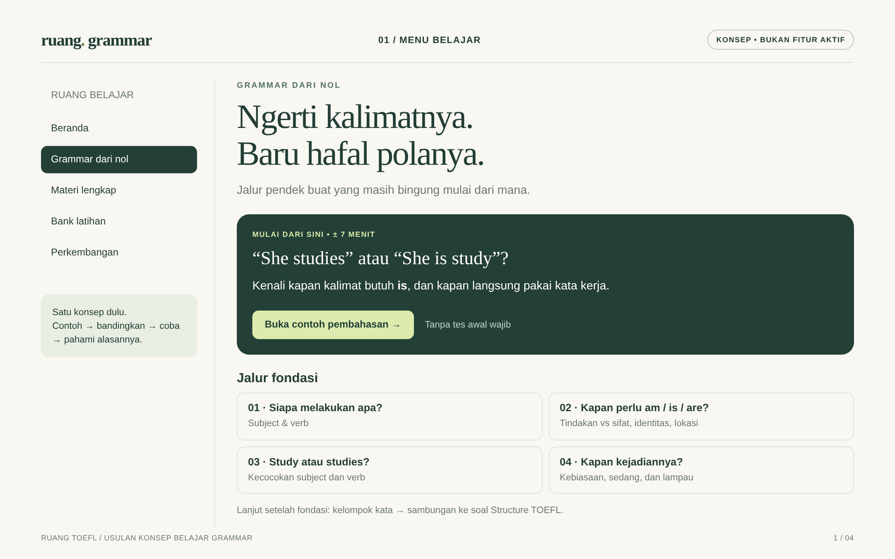
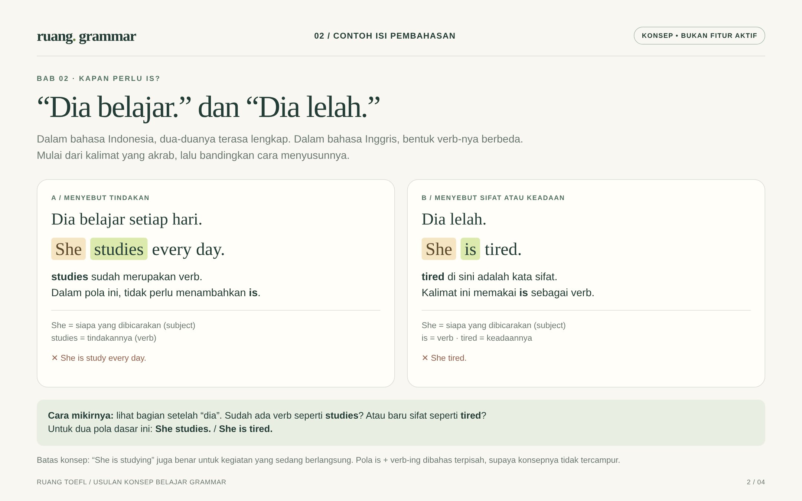
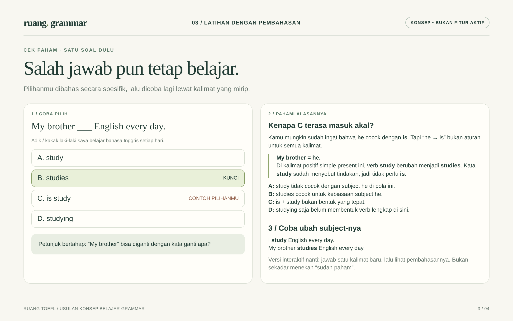
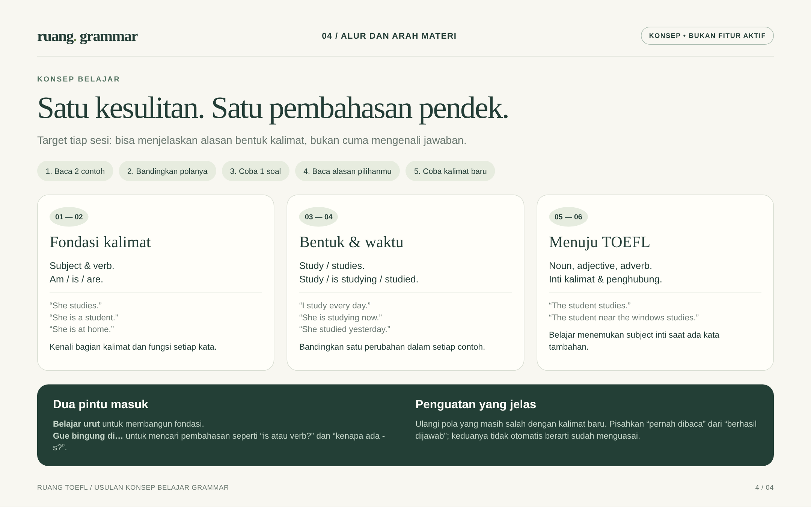

# Konsep Grammar dari Nol

Usulan menu dan pembelajaran grammar yang dimulai dari kalimat sederhana, perbandingan pola, latihan singkat, dan pembahasan alasan setiap pilihan. File di folder ini adalah konsep visual; belum diimplementasikan ke aplikasi.

## File konsep

- [PDF — 4 halaman](Konsep-Grammar-dari-Nol.pdf)
- [PowerPoint — 4 slide](Konsep-Grammar-dari-Nol.pptx)
- [Sumber preview HTML statis](preview.html) — unduh dan buka di browser. Tombol dalam mockup hanya ilustrasi.

## Preview

### 1. Menu Grammar dari Nol

### 2. Contoh pembahasan dengan perbandingan kalimat

### 3. Latihan dan alasan jawaban

### 4. Alur belajar dan urutan materi

## Pendekatan belajar

1. Baca dua contoh kalimat yang akrab.
2. Bandingkan perubahan dan fungsi kata dalam kalimat.
3. Coba satu soal dengan petunjuk bertahap.
4. Pahami alasan pilihan yang benar dan salah.
5. Coba kalimat baru untuk mengecek pemahaman.

Urutan materi: subject dan verb → am/is/are → study/studies → waktu kejadian → kelompok kata → Structure TOEFL. Estimasi durasi pada mockup merupakan sasaran desain, belum hasil pengujian.
